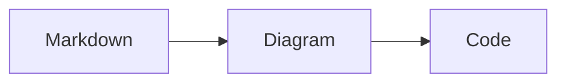

# mdview

A small Markdown viewer and browser editor that prints a clickable loopback URL.
It does not open a browser automatically.

```sh
make install
mdview /tmp/something/abcd.md
# http://127.0.0.1:49152/tmp-something-abcd-md.html
```

The port is assigned by the OS. The filename is the full absolute input path with
separators, dots and spaces replaced by hyphens, followed by `.html`. Very long
paths are shortened with a hash to stay within filesystem filename limits.

The command stays in the foreground. Ctrl+C stops the server and removes its
temporary directory under `/tmp`. Multiple viewers can run at the same time.
Standard output contains the URL; status and errors go to standard error. With
`--watch`, changed browser saves also produce JSON event lines on standard output.

The page renders headings, syntax-highlighted fenced code, tables, task lists,
strikethrough, external links, and automatic light/dark styling. Links open in new
tabs with `target="_blank"` and `rel="noopener noreferrer"`. All CSS is bundled;
rendering requires no network access. Raw HTML and unsafe link schemes are omitted.
Only the opened document, its editing endpoint, and bundled scripts are served;
relative files and local images are not exposed.


## Browser editing

Click **Edit** to edit the Markdown source in your browser. **Save** writes to the
original file and refreshes the rendered page, including diagrams. **Cancel**
discards unsaved edits after confirmation. Cmd+S / Ctrl+S saves while editing.
Unsaved changes trigger a warning when leaving the page. Editing and rendering
work offline; there are no browser dependencies to download.

Saves preserve file permissions and replace the file atomically. A revision check
rejects stale edits when another tab or program has changed the file. On failure,
your draft stays in the editor. Saves are limited to 2 MiB of JSON request data.
The server can only save the file opened by this command. It checks the local Host,
Origin, and a per-session token before accepting writes.

Use `mdview --read-only document.md` to disable editing. Existing running viewers
keep their original behavior until restarted with the new binary.

## Responding to edits with any AI agent

```sh
mdview --watch /absolute/path/to/document.md
mdview --agent-instructions
```

Watch mode prints the URL, instructions, and one JSON event for each changed
browser save. For example:

```json
{"type":"mdview.saved","path":"/tmp/document.md","revision":"new-hash","previousRevision":"old-hash","time":"2026-10-22T12:00:00Z"}
```

[AGENT_INSTRUCTIONS.md](AGENT_INSTRUCTIONS.md) defines the workflow: keep a shell
wait active, read the file when a save event arrives, respond, and resume waiting.
The same instructions work with any agent that can run a command and wait for its
output. There is no model API, thread identifier, app hook, or harness dependency.
A completed agent turn cannot be woken by the viewer alone; automatic responses
require the agent to remain in the documented wait loop.

Code fences use their language tag (for example, `sh`, `json`, `kotlin`, or `sql`)
for highlighting, with bundled light and dark themes. Untagged fences and unknown
languages remain plain code. Highlighting requires no browser scripts or downloads.

Fences tagged `mermaid` render as diagrams with **Diagram** and **Code** tabs.
**Copy** copies the original Mermaid source. **Expand** opens a full-screen modal
with zoom in/out and Fit controls; Escape or Close returns to the document.
Tabs support arrow keys, Home and End. Invalid diagrams keep their source available
and do not prevent other diagrams from rendering.



[Pele](https://pele.run) 1.8.0 renders Mermaid syntax using its own SVG layout
engine. The pinned browser bundle and MIT license (`assets/PELE-LICENSE`) are
embedded in the binary, so diagrams work offline without a CDN or browser
downloads. Diagram rendering requires JavaScript. CSS variables keep diagrams
in sync with the page's light/dark theme. Layout and spacing may differ from
Mermaid.js; Mermaid theme configuration does not apply. Diagram links, images,
and JavaScript click handlers are disabled; raw Markdown HTML remains disabled.

Requires Go 1.25 or later to build. The resulting binary has no runtime dependencies.
Markdown parsing uses [Goldmark](https://github.com/yuin/goldmark); syntax highlighting
uses [Chroma](https://github.com/alecthomas/chroma).

```sh
make check
make build
bin/mdview --help
```

The diagram tests use Node.js to exercise the bundled renderer, including custom
styles, invalid source, and disabled active content. Node.js is only needed for
`make check`, not for building or running mdview.
